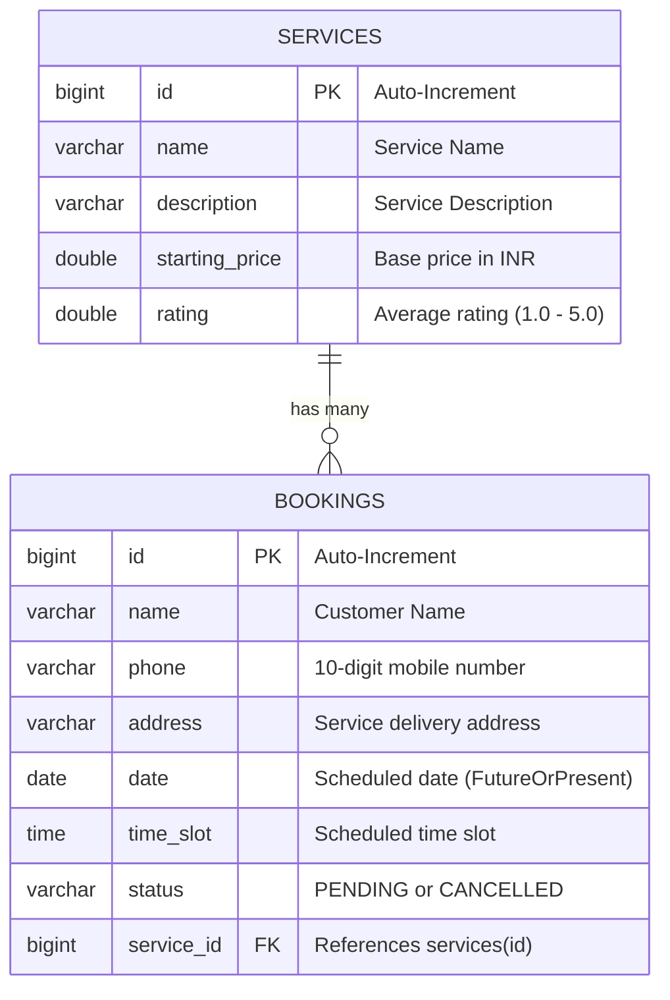

# Home Services Booking REST API

A production-ready Spring Boot backend REST API that enables users to browse available home services (cleaning, plumbing, electrical, carpentry, AC servicing, etc.) and book appointments with strict input validation, standardized error handling, appointment lifecycle tracking, and automatic catalog initialization.

> **Assessment Context**: Developed for the **AdityaX Innovations - Java Full Stack Developer Assessment**.

---

## 📋 Table of Contents
- [Project Overview](#-project-overview)
- [Key Features](#-key-features)
- [Technology Stack](#-technology-stack)
- [System Architecture & Design](#-system-architecture--design)
- [Database Schema & Data Model](#-database-schema--data-model)
- [API Reference & Specifications](#-api-reference--specifications)
- [Interactive API Documentation (Swagger UI)](#-interactive-api-documentation-swagger-ui)
- [Postman API Testing](#-postman-api-testing)
- [Automated Testing (JUnit 5 & Mockito)](#-automated-testing-junit-5--mockito)
- [Setup & Installation](#-setup--installation)
- [Developer & AI Agent Notes](#-developer--ai-agent-notes)

---

## 🌟 Project Overview

The **Home Services Booking API** is designed to power on-demand home service platforms (similar to Urban Company). It provides reliable RESTful interfaces for:
1. **Service Discovery**: Exploring categorized services with descriptions, starting prices, and customer ratings, including case-insensitive search filtering.
2. **Booking Management**: Scheduling appointments with validated contact information, booking dates, and time slots.
3. **Lifecycle Management**: Tracking booking states (`PENDING`, `CANCELLED`) with cancellation capabilities.
4. **Data Integrity**: Enforcing strict validation rules (10-digit phone number regex, future-or-present dates, non-blank fields) and returning structured validation error payloads.

---

## ✨ Key Features

- **Automatic Database Seeding**: On application startup, a `CommandLineRunner` automatically seeds 8 home service offerings if the database table is empty.
- **Search & Filtering**: Query services dynamically with case-insensitive keyword search (`/api/services?search=clean`).
- **Comprehensive Validation**: Validates client requests using Jakarta Validation (`@Valid`, `@NotBlank`, `@Pattern`, `@FutureOrPresent`, `@NotNull`).
- **Standardized Error Handling**: Centralized `@RestControllerAdvice` translates entity lookup failures into `404 Not Found` and validation errors into structured `400 Bad Request` maps.
- **Bonus Feature Implemented**: Dedicated booking cancellation endpoint (`PATCH /api/bookings/{id}/cancel`).
- **Interactive OpenAPI / Swagger Documentation**: Preconfigured with `springdoc-openapi` for browser-based API testing.
- **Turnkey Postman Collection**: Full collection file included with positive, negative, and validation scenarios.
- **Automated Test Coverage**: 100% passing test suite combining Mockito unit tests and Spring Boot JPA integration tests.

---

## 🛠 Technology Stack

| Layer / Concern | Technology | Version | Description |
| :--- | :--- | :--- | :--- |
| **Language** | Java (JDK) | 17 LTS | Core programming language |
| **Framework** | Spring Boot | 4.0.8 / 3.x | Application framework & IoC container |
| **Web Layer** | Spring MVC | Embedded Tomcat 11 | RESTful controllers, routing, JSON serialization |
| **Persistence** | Spring Data JPA | Hibernate 7.x | Object-Relational Mapping (ORM) and repositories |
| **Database** | MySQL | 8.0+ | Relational persistence storage |
| **Connection Pool** | HikariCP | 5.x | High-performance JDBC connection pooling |
| **Validation** | Jakarta Bean Validation | Hibernate Validator | Input validation constraints (`@Valid`, `@Pattern`) |
| **Boilerplate Reduction**| Project Lombok | 1.18.x | Property accessors (`@Getter`, `@Setter`) |
| **API Documentation** | SpringDoc OpenAPI | 3.1.x | OpenAPI 3.0 specification & Swagger UI |
| **Testing Framework** | JUnit 5 (Jupiter) | 5.x | Unit and integration testing |
| **Mocking Library** | Mockito | 5.x | Mocking repositories in isolated service tests |
| **Build Tool** | Apache Maven | 3.9+ / Wrapper | Dependency management and build automation |

---

## 🏛 System Architecture & Design

The application follows the industry-standard **Layered Architecture** with strict separation of concerns:

```
[ HTTP Clients / Postman / Swagger UI ]
                   │
                   ▼
    ┌──────────────────────────────┐
    │      Controller Layer        │  <-- REST Endpoints, DTO Validation (@Valid)
    │   (Service / Booking API)    │
    └──────────────┬───────────────┘
                   │  (DTOs)
                   ▼
    ┌──────────────────────────────┐
    │        Service Layer         │  <-- Business Logic, Transactions (@Transactional),
    │   (Service & Booking Impl)   │      Entity-DTO Mapping
    └──────────────┬───────────────┘
                   │  (JPA Entities)
                   ▼
    ┌──────────────────────────────┐
    │       Repository Layer       │  <-- Spring Data JPA Data Access Object (DAO)
    │  (Service / Booking Repos)   │
    └──────────────┬───────────────┘
                   │  (SQL Queries via Hibernate)
                   ▼
    ┌──────────────────────────────┐
    │     MySQL 8.0 Database       │  <-- Relational Tables (`services`, `bookings`)
    └──────────────────────────────┘
```

### 📂 Directory Structure

```
home-services-booking/
├── src/
│   ├── main/
│   │   ├── java/com/adityax/homeservices/
│   │   │   ├── HomeServicesBookingApplication.java  # Application Entry Point
│   │   │   ├── config/
│   │   │   │   ├── DataInitializer.java              # CommandLineRunner seeding 8 services
│   │   │   │   └── SwaggerConfig.java                # OpenAPI 3.0 bean configuration
│   │   │   ├── controller/
│   │   │   │   ├── BookingController.java            # /api/bookings endpoints
│   │   │   │   └── ServiceController.java            # /api/services endpoints
│   │   │   ├── dto/
│   │   │   │   ├── ApiErrorResponse.java             # Standardized error payload
│   │   │   │   ├── BookingRequest.java               # Validation constraints on booking payload
│   │   │   │   ├── BookingResponse.java              # Client-safe booking response
│   │   │   │   └── ServiceResponse.java              # Client-safe service response
│   │   │   ├── entity/
│   │   │   │   ├── Booking.java                      # JPA Entity for `bookings` table
│   │   │   │   ├── BookingStatus.java                # Enum: PENDING, CANCELLED
│   │   │   │   └── ServiceEntity.java                # JPA Entity for `services` table
│   │   │   ├── exception/
│   │   │   │   ├── GlobalExceptionHandler.java       # @RestControllerAdvice error handler
│   │   │   │   └── ResourceNotFoundException.java   # Custom 404 RuntimeException
│   │   │   ├── mapper/
│   │   │   │   └── BookingMapper.java                # Converts Booking Entity -> BookingResponse DTO
│   │   │   ├── repository/
│   │   │   │   ├── BookingRepository.java            # JpaRepository<Booking, Long>
│   │   │   │   └── ServiceRepository.java            # JpaRepository<ServiceEntity, Long>
│   │   │   └── service/
│   │   │       ├── BookingService.java               # Interface for booking operations
│   │   │       ├── ServiceService.java               # Interface for service catalog operations
│   │   │       └── impl/
│   │   │           ├── BookingServiceImpl.java       # Business logic implementation
│   │   │           └── ServiceServiceImpl.java       # Business logic implementation
│   │   └── resources/
│   │       └── application.properties                # Database, JPA, and server settings
│   └── test/
│       └── java/com/adityax/homeservices/
│           ├── HomeServicesBookingApplicationTests.java  # Spring Boot Context & DB Integration Test
│           └── service/impl/
│               └── ServiceServiceImplTest.java           # Unit tests with Mockito mocks
├── Home_Services_Booking_API.postman_collection.json     # Turnkey Postman Collection
├── pom.xml                                               # Maven dependencies & plugins
├── mvnw / mvnw.cmd                                       # Maven Wrapper scripts
└── README.md                                             # Project documentation
```

---

## 🗄 Database Schema & Data Model

### Entity-Relationship Diagram



### Preloaded Services Data
On first boot, the system preloads the following catalog:
1. **Home Cleaning** (₹999.0, Rating: 4.5)
2. **Deep Cleaning** (₹1999.0, Rating: 4.8)
3. **Plumbing** (₹499.0, Rating: 4.3)
4. **Electrical Repairs** (₹599.0, Rating: 4.4)
5. **AC Servicing** (₹799.0, Rating: 4.6)
6. **Painting** (₹2999.0, Rating: 4.2)
7. **Carpentry** (₹699.0, Rating: 4.1)
8. **Pest Control** (₹899.0, Rating: 4.5)

---

## 📡 API Reference & Specifications

**Base URL**: `http://localhost:8080`

### 1. Services Endpoints

#### `GET /api/services`
Retrieves all services. Supports optional keyword search.

- **Query Parameters**:
  - `search` *(optional, string)*: Filter services by name (case-insensitive substring match).
- **Response**: `200 OK`
```json
[
  {
    "id": 1,
    "name": "Home Cleaning",
    "description": "Professional home cleaning service",
    "startingPrice": 999.0,
    "rating": 4.5
  },
  {
    "id": 2,
    "name": "Deep Cleaning",
    "description": "Thorough cleaning of the entire home",
    "startingPrice": 1999.0,
    "rating": 4.8
  }
]
```

#### `GET /api/services/{id}`
Retrieves full details of a specific service by ID.

- **Path Variable**: `id` *(required, integer)*
- **Response**: `200 OK`
```json
{
  "id": 1,
  "name": "Home Cleaning",
  "description": "Professional home cleaning service",
  "startingPrice": 999.0,
  "rating": 4.5
}
```
- **Error Response**: `404 Not Found` (when service ID does not exist)
```json
{
  "timestamp": "2026-10-17T01:30:00.000",
  "status": 404,
  "message": "Service not found with id: 999",
  "errors": null
}
```

---

### 2. Bookings Endpoints

#### `POST /api/bookings`
Creates a new service booking appointment.

- **Headers**: `Content-Type: application/json`
- **Request Body**:
```json
{
  "serviceId": 1,
  "name": "Rahul Sharma",
  "phone": "9876543210",
  "address": "Flat 402, Green Valley Apartments, Kharadi, Pune",
  "date": "2026-10-25",
  "timeSlot": "10:00:00"
}
```
- **Validation Rules**:
  - `serviceId`: Must not be null. Must correspond to an existing service ID.
  - `name`: Must not be blank.
  - `phone`: Must not be blank. Must match regex `^[0-9]{10}$` (exactly 10 numeric digits).
  - `address`: Must not be blank (up to 500 characters).
  - `date`: Must not be null. Must be in the present or future (`@FutureOrPresent`).
  - `timeSlot`: Must not be null (`LocalTime` format `HH:mm:ss`).
- **Response**: `201 Created`
```json
{
  "id": 1,
  "serviceName": "Home Cleaning",
  "name": "Rahul Sharma",
  "phone": "9876543210",
  "address": "Flat 402, Green Valley Apartments, Kharadi, Pune",
  "date": "2026-10-25",
  "timeSlot": "10:00:00",
  "status": "PENDING"
}
```
- **Error Response**: `400 Bad Request` (when validation fails)
```json
{
  "timestamp": "2026-10-17T01:30:00.000",
  "status": 400,
  "message": "Validation failed",
  "errors": {
    "name": "Name is required",
    "phone": "Phone number must contain exactly 10 digits",
    "date": "Booking date cannot be in the past"
  }
}
```

#### `GET /api/bookings`
Retrieves all customer bookings across all services.

- **Response**: `200 OK`
```json
[
  {
    "id": 1,
    "serviceName": "Home Cleaning",
    "name": "Rahul Sharma",
    "phone": "9876543210",
    "address": "Flat 402, Green Valley Apartments, Kharadi, Pune",
    "date": "2026-10-25",
    "timeSlot": "10:00:00",
    "status": "PENDING"
  }
]
```

#### `PATCH /api/bookings/{id}/cancel` *(Bonus Feature)*
Cancels an existing appointment by changing its status from `PENDING` to `CANCELLED`.

- **Path Variable**: `id` *(required, integer)*
- **Response**: `200 OK`
```json
{
  "id": 1,
  "serviceName": "Home Cleaning",
  "name": "Rahul Sharma",
  "phone": "9876543210",
  "address": "Flat 402, Green Valley Apartments, Kharadi, Pune",
  "date": "2026-10-25",
  "timeSlot": "10:00:00",
  "status": "CANCELLED"
}
```
- **Error Response**: `404 Not Found` (when booking ID does not exist)

---

## 📖 Interactive API Documentation (Swagger UI)

SpringDoc OpenAPI 3 is integrated into the application. While the server is running, you can explore, test, and view schemas directly:

- **Swagger UI Console**: [http://localhost:8080/swagger-ui.html](http://localhost:8080/swagger-ui.html)
- **OpenAPI 3.0 JSON Spec**: [http://localhost:8080/v3/api-docs](http://localhost:8080/v3/api-docs)

---

## 🧪 Postman API Testing

A complete Postman collection is committed directly in the project repository:
📁 [`Home_Services_Booking_API.postman_collection.json`](./Home_Services_Booking_API.postman_collection.json)

### How to Import & Run:
1. Open **Postman**.
2. Click **Import** (top left).
3. Select or drag-and-drop `Home_Services_Booking_API.postman_collection.json`.
4. The imported collection contains organized folders:
   - **1. Services**:
     - `GET All Services`
     - `GET Services with Search Filter (?search=clean)`
     - `GET Service by ID (Valid)`
     - `GET Service by ID (404 Not Found)`
   - **2. Bookings**:
     - `POST Create Booking (Valid - 201 Created)`
     - `POST Create Booking (400 Validation Error - Invalid Phone & Empty Name)`
     - `POST Create Booking (404 Service Not Found)`
     - `GET All Bookings`
     - `PATCH Cancel Booking (200 OK)`
     - `PATCH Cancel Booking (404 Not Found)`

All requests use a collection variable `{{baseUrl}} = http://localhost:8080`.

---

## 🧪 Automated Testing (JUnit 5 & Mockito)

The test suite covers both unit-level business logic and full Spring Boot integration:

1. **`ServiceServiceImplTest`** *(Unit Tests)*:
   - Uses Mockito (`@Mock`, `when(...)`, `verify(...)`) to test service logic in complete isolation without hitting the database.
   - Tests:
     - `getAllServicesShouldReturnAllServices()`: Verifies fetching all services.
     - `searchShouldReturnMatchingServices()`: Verifies search keyword delegation.
     - `getServiceByIdShouldThrowExceptionWhenNotFound()`: Verifies exception propagation.
2. **`HomeServicesBookingApplicationTests`** *(Integration Test)*:
   - Loads the full Spring Boot application context.
   - Verifies database connectivity, Hibernate entity mapping, Hikari connection pool, and repository bootstrapping.

### Running Tests from CLI:

```powershell
# Run the complete test suite
.\mvnw.cmd test

# Run a specific test class
.\mvnw.cmd test -Dtest=ServiceServiceImplTest

# Run a single test method
.\mvnw.cmd test -Dtest=ServiceServiceImplTest#getAllServicesShouldReturnAllServices
```

### Running Tests in Eclipse / Spring Tool Suite:
- Right-click `ServiceServiceImplTest.java` > **Run As** > **JUnit Test** (`Alt + Shift + X, T`).
- All tests execute with a clean green bar (`0 Errors, 0 Failures`).

---

## ⚙ Setup & Installation

### 1. Prerequisites
- **JDK 17 LTS** (Eclipse Adoptium Temurin or Oracle JDK 17 recommended)
- **MySQL Server 8.0+** running locally on port `3306`
- **Maven 3.8+** (or use the included `./mvnw` / `mvnw.cmd` wrapper)

### 2. Database Setup
Log into your MySQL client and run:
```sql
CREATE DATABASE IF NOT EXISTS home_services_db;
```

Verify your credentials in [`src/main/resources/application.properties`](./src/main/resources/application.properties):
```properties
spring.application.name=home-services-booking

# MySQL Database Configuration
spring.datasource.url=jdbc:mysql://localhost:3306/home_services_db
spring.datasource.username=root
spring.datasource.password=root

# JPA & Hibernate Configuration
spring.jpa.hibernate.ddl-auto=update
spring.jpa.show-sql=true

# Server Port
server.port=8080
```

### 3. Build & Run the Application

#### Using Maven Wrapper (CLI):
```powershell
# Windows
.\mvnw.cmd clean compile
.\mvnw.cmd spring-boot:run

# Linux / macOS
./mvnw clean compile
./mvnw spring-boot:run
```

#### Running the Packaged JAR:
```powershell
.\mvnw.cmd clean package -DskipTests
java -jar target/home-services-booking-0.0.1-SNAPSHOT.jar
```

#### Running in Eclipse / Spring Tool Suite:
1. Import as an **Existing Maven Project**.
2. Open `HomeServicesBookingApplication.java`.
3. Right-click > **Run As** > **Spring Boot App**.

---
